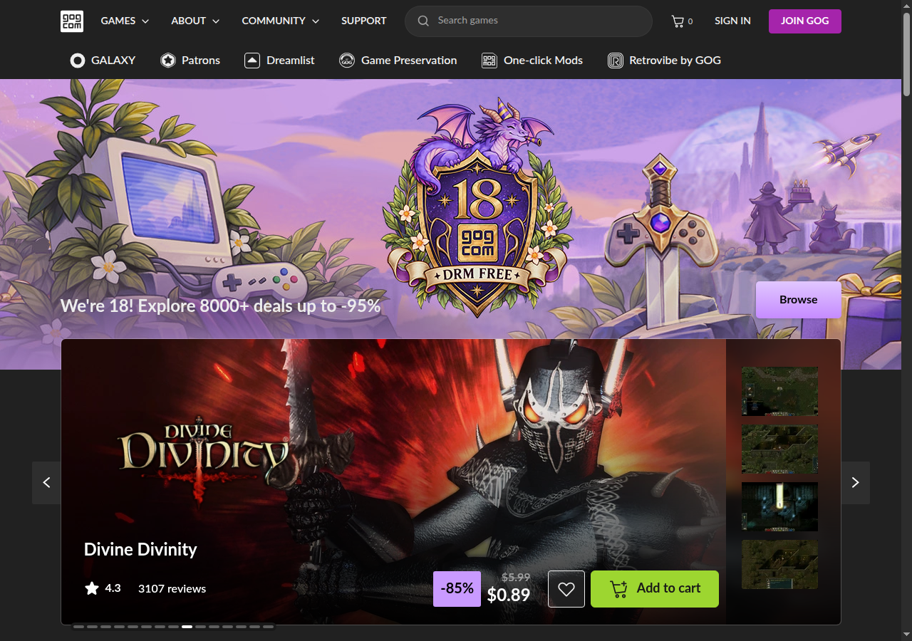

# Assignment 2

Name: Azeem Sarwar  
Roll number: FA24-BCS-026

Reference site: GOG  
URL: https://www.gog.com/en/

Game Store follows GOG's dark header, sale banner, featured game, game cards and green cart buttons. It uses a smaller layout with a static banner, eight games and a basic footer.

Open `index.html` in a browser. Click the featured game to open `product.html`.
Bootstrap CSS loads from the CDN shown in Lecture 10, so an internet connection is needed. The cart buttons are static for Assignment 2.

## Course material used

- Lectures 3 and 4: HTML pages, links, images, semantic elements and the quantity input.
- Lectures 5 and 6: external CSS, colours, fonts, backgrounds, margins, padding and borders.
- Lecture 9: Flexbox for the navigation and banner content.
- Lecture 10: Bootstrap navbar and grid, responsive images and media queries.

Course notes: https://cuinotes.com/web-technologies/

Artwork and visual reference: GOG. Prices are fixed examples for this assignment, not live offers. This is a coursework page, not a real store.
